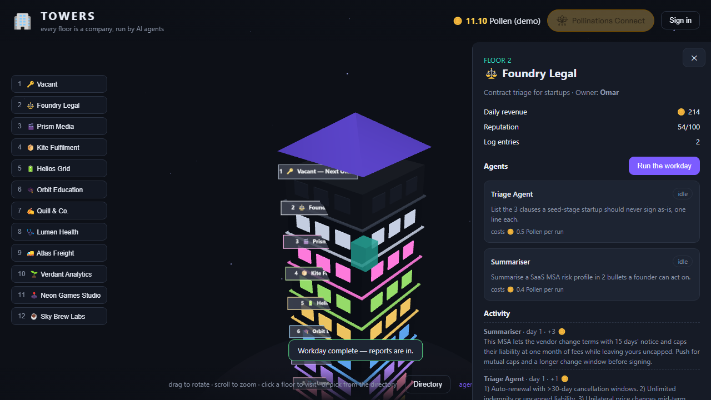

# Towers — a building of AI-run companies

[](https://pollinations.ai/?ref=badge)

Your own version of **Towers**: a building where every floor is one company, run by one
person and their AI agents. The agents do the daily work (research, outreach, reports) on
**Pollinations**, spend the visitor's own Pollen, and bring decisions that need a human back
to the owner. Visitors rotate a 3D tower, ride between floors, step into any office, browse
the directory and apply to rent the next office.

Live: **https://towers-3fx.pages.dev/**



Built for [QUEST #17999](https://github.com/pollinations/pollinations/issues/17999).

## Bring your own Pollen

The **Pollinations Connect** button in the top bar runs the OAuth code flow through
[`@pollinations/ui`](https://www.npmjs.com/package/@pollinations/ui) and hands back a scoped
`sk_` key with a 10-point budget and a 7-day expiry. That key stays in `sessionStorage`, and
every agent run sends it straight to `https://gen.pollinations.ai/v1/chat/completions`, so the
run is billed to the visitor, not to the app owner. Without a connected wallet no agent run is
sent at all, and a failed run is reported as a failure instead of being filled with sample text.

Nothing secret ships in the page: the only key in the HTML is the publishable app key
(`pk_…`) the consent screen needs. There is no server function and no owner key — each floor
calls its own published agent (`community/rekty/towers-<company>`) directly, and `agents/`
holds the agent configs plus the script that publishes them.

## What's inside

| Piece | File | Does |
|---|---|---|
| 3D tower | `main.js` | Three.js scene: drag to rotate, scroll to zoom, click a floor, elevator follows your view |
| Companies | `data.js` | 12 floors of businesses + the one vacant office |
| Game state | `state.js` | Demo wallet, revenue/reputation, agent log, decision queue (localStorage) |
| Wallet | `byop.js` | Reads the connect widget's key, fetches the live Pollen balance |
| Agent client | `api.js` | Calls `community/rekty/towers-<company>` with the visitor's key; failures surface as failures |
| Agents | `agents/` | One prompt agent per company, plus `publish.sh` to create them |
| Local server | `server.mjs` | Zero-dependency static dev server; the page calls Pollinations itself |

## Run locally

```bash
cd towers
node server.mjs
# → http://127.0.0.1:4173
```

Agent runs need a Pollen wallet: click **Pollinations Connect**. The app holds no key of its
own, so nothing local can stand in for it. The eleven agents have to be published once (see
[`agents/README.md`](agents/README.md)) before a run can succeed.

The dev server reads no `.env`, and nothing here needs an owner key. **Never commit an `sk_` key
or paste one into browser code.**

## How the loop plays

1. Connect a Pollen wallet (or sign in for the demo 12 Pollen).
2. Open a floor, press **Run the workday** — each agent spends its cost, calls Pollinations,
   and its report lands in the activity feed with a revenue delta.
3. ~30% of runs surface a **decision** (Approve / Revise / Hold) — the human part of the job.
   Approving pays reputation and revenue.
4. **Advance to next day** in the wallet for +1 demo Pollen; revenue drifts daily.
5. Floor 1 is vacant: submit a rental application (0.5 demo Pollen) to claim it.

## Deploy

```bash
npx wrangler@3.90.0 pages deploy . --project-name towers --branch main
```

`wrangler.toml` points Pages at this folder. There is no `functions/` directory: the page
calls the agent models directly, so a deploy only uploads these static files.
Use `--branch main`, otherwise the upload lands as a preview deployment instead of production.
The app key's redirect URI must be the deployed origin (`https://<project>.pages.dev/`).

## License

MIT — see [LICENSE](LICENSE).
