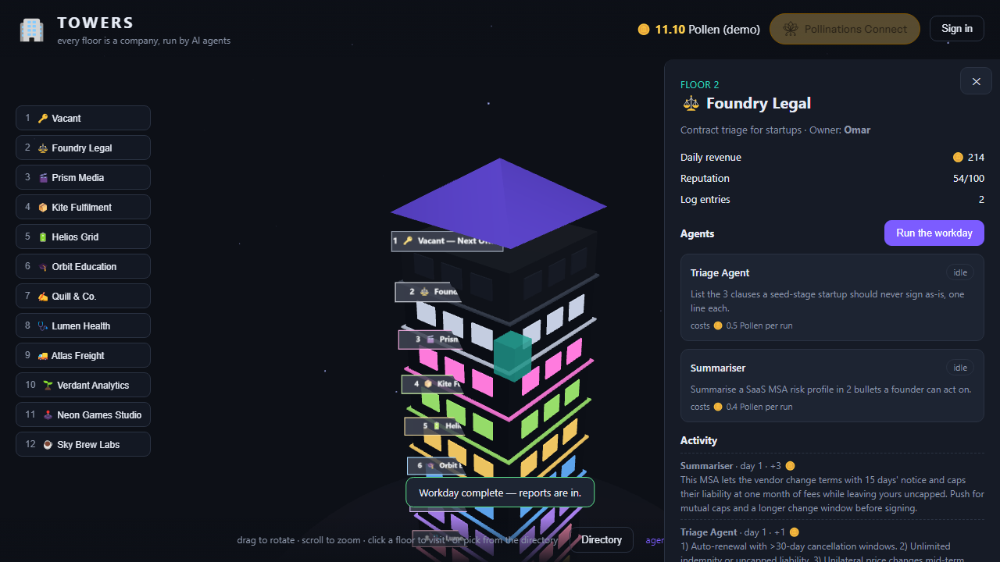

### App Name

Towers

### App Description

Rotate a 3D tower, ride to any floor and run the workday: agents on Pollinations do the research and reports, then bring the decision back to you. Visitors pay with their own Pollen.

### App URL

https://towers-ei1.pages.dev/

### GitHub Repository URL

https://github.com/rekty/towers

### App Category

business

### Platform

web

### App Language

en

### Screenshot

### Quest

#17999

### Pollinations integration (evidence)

The live app calls `https://gen.pollinations.ai/v1/chat/completions` for every agent run, billed to the visitor's own Pollen:

- [`agents/`](https://github.com/rekty/towers/tree/main/agents) — one Pollinations prompt agent per company (`community/rekty/towers-<company>`); the page calls it directly with the visitor's own key, and there is no server proxy and no owner key.
- [byop.js](https://github.com/rekty/towers/blob/main/byop.js) — reads the scoped key from the `<polli-connect>` OAuth widget and fetches the live balance from `https://gen.pollinations.ai/account/balance`.
- [index.html](https://github.com/rekty/towers/blob/main/index.html) — the `polli-connect` element (app key `pk_jgOiUY2xiIeg7GFF`, budget 10, expiry 7 days) that runs the consent flow.
- Live check: open floor 2 → **Run the workday**; the report in Activity is a model reply, and the wallet in the top bar shows the connected Pollen budget dropping after each run.
- The page footer credits both hosts ("agents run on pollinations.ai" / "model calls via gen.pollinations.ai"). There is no Pages Function and no owner key: `api.js` posts straight to the chat endpoint.
